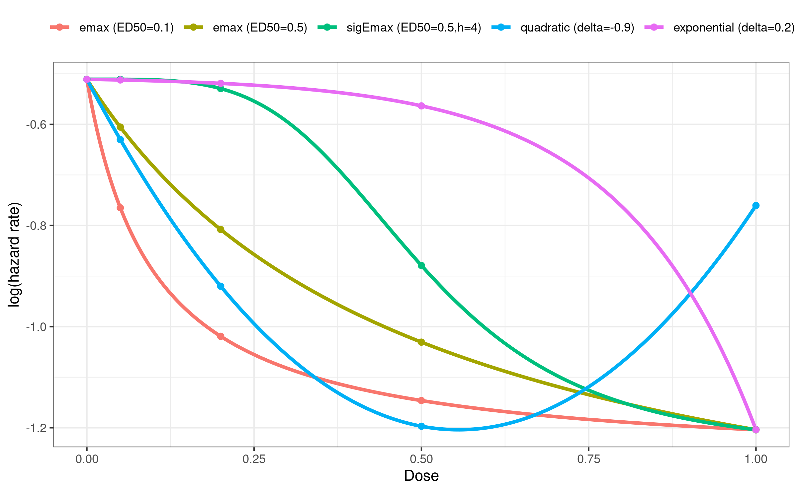
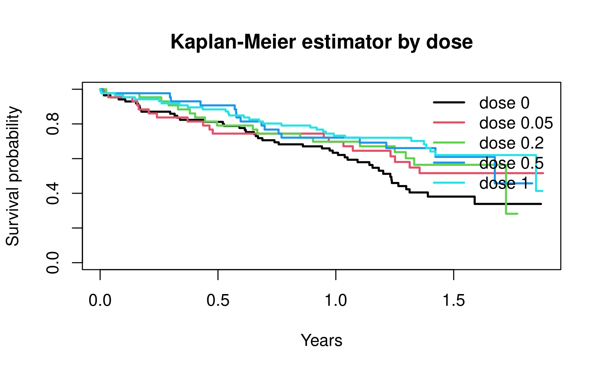
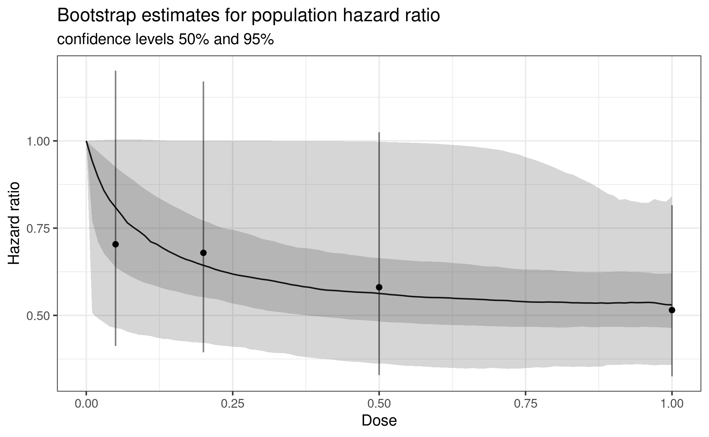

# Time-to-Event Data MCP-Mod

In this vignette we illustrate how to use the `DoseFinding` package with
time-to-event (survival) endpoints. We show how to simulate a
dose-finding trial, how to apply the generalized MCP-Mod methodology to
the log hazard ratios estimated from a Cox proportional hazards model,
and how to perform power and sample size calculations following Deng et
al. ([2019](#ref-deng2019)).

For continuously distributed data see the [analysis of normal data
vignette](https://openpharma.github.io/DoseFinding/articles/analysis_normal.md),
and for binary data the [binary data
vignette](https://openpharma.github.io/DoseFinding/articles/binary_data.md).

``` r

library(DoseFinding)
library(ggplot2)
library(survival)
## set seed and ensure reproducibility across R versions
set.seed(2010, kind = "Mersenne-Twister", sample.kind = "Rejection", normal.kind = "Inversion")
```

## Example trial

We will first generate an appropriate dataset that we can use to
illustrate the analysis of time-to-event data.

Assume a dose-finding study is planned for a hypothetical
investigational treatment. The endpoint of interest is the time to a
certain event. The treatment is tested with doses 0 (placebo), 0.05,
0.2, 0.5 and 1, with an allocation ratio of 2:1:1:1:2. The larger
allocation to placebo and highest dose is chosen to increase the power.
It is assumed that the hazard rate for the placebo group is \\\lambda_0
= 0.6\\ and that the hazard ratio for the maximum effect over the dose
range is \\\text{HR} = 0.5\\. This results in a hazard rate of
\\\lambda_1 = 0.3\\.

We define the parameters for the example just described:

``` r

doses <- c(0, 0.05, 0.2, 0.5, 1) # placebo and 4 treatment groups
lambda0 <- 0.6 # yearly hazard rate for the placebo group
HR1 <- 0.5 # hazard ratio for the treatment effect at the highest dose
lambda1 <- lambda0 * HR1 # hazard rate for the highest dose
alRatio <- c(2, 1, 1, 1, 2) # allocation ratio across the dose groups
```

We use the following candidate set of dose-response models for the mean
response: an \\\text{E}\_{\text{max}}\\, a sigmoidal
\\\text{E}\_{\text{max}}\\, a quadratic and an exponential model.

In the survival context a *decreasing* response (a lower hazard)
typically corresponds to a beneficial treatment effect, so we specify
`direction = "decreasing"`.

The dose-response models are placed on the *log hazard* scale, because
dose-response models in the `DoseFinding` package assume additive
effects. Consequently:

- `placEff` is the log hazard rate of the placebo arm,
  i.e. \\\log(\lambda_0)\\.
- `maxEff` is the maximum treatment effect within the dose range,
  i.e. the difference between the response at the highest dose and
  `placEff`. On the log hazard scale this equals the log hazard ratio,
  since \\ \log(\text{HR}) = \log(\lambda_1) - \log(\lambda_0). \\

``` r

mods <- Mods(
  emax = c(0.1, 0.5),
  sigEmax = c(0.5, 4),
  quadratic = -0.9,
  exponential = 0.2,
  doses = doses,
  direction = "decreasing", # decreasing (lower hazard) is beneficial
  placEff = log(lambda0), # log hazard rate of the placebo arm
  maxEff = log(lambda1) - log(lambda0) # log hazard ratio at the highest dose
)
plotMods(mods, superpose = TRUE, ylab = "log(hazard rate)")
```

 To
illustrate the methodology we simulate a survival data set based on the
trial assumptions and one of our assumed candidate models. The function
below draws survival times from an exponential distribution under one of
the candidate models. It supports

- *event-driven censoring*: the study is run until a total of `etotal`
  events have been observed, and
- optional *staggered study entry*: an entry (calendar) time is added to
  each patient’s event time, the data are censored on the calendar-time
  scale at the time of the `etotal`-th event, and the observed follow-up
  time is then expressed on the study-time scale.

``` r

#' @param mods `Mods` object defining the candidate models to simulate from
#' @param model name or index of the model whose hazards are used to simulate
#'    (refers to column names or column indices of getResp(mods))
#' @param alRatio allocation ratio across the dose groups
#' @param n total sample size
#' @param etotal number of events at which event-driven censoring is applied
#' @param staggered logical, whether to use staggered study entry
#' @return data.frame with columns group, time, status
simulate_surv_data <- function(mods, model, alRatio, n, etotal,
                               staggered = FALSE) {
  doses <- attr(mods, "doses")
  y <- getResp(mods)
  lambda0 <- exp(attr(mods, "placEff"))
  ## assign each patient to a dose group (log hazard rate) according to alRatio
  log_rate_resp <- rep(y[, model], rndDesign(alRatio/sum(alRatio), n))

  ## entry (calendar) times
  entry <- if (staggered) {
    runif(n, 0, qexp(etotal / n, lambda0))
  } else {
    rep(0, n)
  }

  ## event times on the calendar-time scale
  event <- entry + rexp(n, exp(log_rate_resp))

  ## event-driven censoring at the time of the etotal-th event
  t_cut <- sort(event)[etotal]
  status <- as.numeric(event <= t_cut)
  obs_time <- pmin(event, t_cut) - entry # follow-up on the study-time scale

  data.frame(
    group = factor(names(log_rate_resp), levels = as.character(doses)),
    time = obs_time,
    status = status
  )
}
```

We simulate a trial of 300 patients using the hazards from the
\\\text{E}\_{\text{max}}\\ model (`model = 1`) and assuming we will
require 130 events.

``` r

n <- 300
dat <- simulate_surv_data(
  mods, model = 1, alRatio = alRatio, n = n, etotal = 130,
  staggered = TRUE
)
head(dat)
```

      group       time status
    1     0 1.29867714      1
    2     0 0.16112692      1
    3     0 0.04348961      1
    4     0 1.08575291      0
    5     0 0.44484421      1
    6     0 1.32996990      0

We can use a Kaplan-Meier plot to visualize the survival times by dose.

``` r

km <- survfit(Surv(time, status) ~ group, data = dat)
plot(km, col = seq_along(doses), lwd = 2,
     xlab = "Years", ylab = "Survival probability",
     main = "Kaplan-Meier estimator by dose")
legend("topright", legend = paste("dose", doses),
       col = seq_along(doses), lwd = 2, bty = "n")
```



## Analysis with MCP-Mod

We will now walk through the typical steps of a MCP-Mod analysis using
our simulated trial data.

### MCP step

The generalized MCP-Mod approach requires an estimate \\\hat\mu\\ of the
(in this case placebo-adjusted) dose-group effects together with its
covariance matrix \\\hat S\\. We obtain both from a Cox proportional
hazards model, which expresses the hazard as \\ \lambda(t \mid
\text{dose}) = \lambda_0(t)\exp(\beta_1 x_1 + \dots + \beta_p x_p), \\
where the coefficients \\\beta\\ are the log hazard ratios of each dose
group relative to placebo.

``` r

coxfit <- coxph(Surv(time, status) ~ group, data = dat)
summary(coxfit)
```

    Call:
    coxph(formula = Surv(time, status) ~ group, data = dat)

      n= 300, number of events= 130 

                 coef exp(coef) se(coef)      z Pr(>|z|)   
    group0.05 -0.3513    0.7038   0.2727 -1.288  0.19775   
    group0.2  -0.3868    0.6792   0.2776 -1.393  0.16355   
    group0.5  -0.5437    0.5806   0.2899 -1.875  0.06074 . 
    group1    -0.6632    0.5152   0.2344 -2.829  0.00466 **
    ---
    Signif. codes:  0 '***' 0.001 '**' 0.01 '*' 0.05 '.' 0.1 ' ' 1

              exp(coef) exp(-coef) lower .95 upper .95
    group0.05    0.7038      1.421    0.4124    1.2011
    group0.2     0.6792      1.472    0.3942    1.1704
    group0.5     0.5806      1.722    0.3289    1.0248
    group1       0.5152      1.941    0.3254    0.8156

    Concordance= 0.569  (se = 0.025 )
    Likelihood ratio test= 9.02  on 4 df,   p=0.06
    Wald test            = 9.18  on 4 df,   p=0.06
    Score (logrank) test = 9.42  on 4 df,   p=0.05

``` r

coef_cox <- coef(coxfit) # placebo-adjusted log hazard ratios
S_cox <- vcov(coxfit) # covariance matrix of the estimates
```

We now test for a dose-response signal with
[`MCTtest()`](https://openpharma.github.io/DoseFinding/reference/MCTtest.md).
Since the coxfit model returns placebo-adjusted estimates (there is no
placebo coefficient), we use `placAdj = TRUE` and drop the placebo dose
from `dose`, we test one-sided.

``` r

mct <- MCTtest(
  dose = doses[-1], # placebo-adjusted, so drop placebo
  resp = coef_cox,
  S = S_cox,
  models = mods,
  type = "general",
  alternative = "one.sided",
  placAdj = TRUE
)
mct
```

    Multiple Contrast Test

    Contrasts:
          emax1  emax2 sigEmax quadratic exponential
    0.05  0.150  0.263   0.254     0.217       0.195
    0.2  -0.246 -0.024   0.218    -0.406       0.175
    0.5  -0.390 -0.286  -0.164    -0.880       0.112
    1    -0.875 -0.921  -0.928    -0.116      -0.959

    Contrast Correlation:
                emax1 emax2 sigEmax quadratic exponential
    emax1       1.000 0.958   0.810     0.786       0.680
    emax2       0.958 1.000   0.940     0.659       0.832
    sigEmax     0.810 0.940   1.000     0.414       0.936
    quadratic   0.786 0.659   0.414     1.000       0.131
    exponential 0.680 0.832   0.936     0.131       1.000

    Multiple Contrast Test:
                t-Stat   adj-p
    emax1        2.962 0.00431
    emax2        2.856 0.00643
    sigEmax      2.510 0.01646
    exponential  2.192 0.03639
    quadratic    2.112 0.04414

The output reports, per candidate model, the optimal-contrast
\\t\\-statistics together with multiplicity-adjusted \\p\\-values. Small
adjusted \\p\\-values give evidence for a dose-response relationship. If
we would have specified a significance level of 0.025 one-sided, then we
can consider the null hypothesis of no dose-response effect versus
placebo is rejected since several of the adjusted p-values are smaller
than 0.025.

### Dose-response estimation

Dose-response modeling can then proceed with a combination of
bootstrapping and model averaging. For detailed explanations refer to
the [vignette for analysis of continuous
data](https://openpharma.github.io/DoseFinding/articles/analysis_normal.md).
Fitting is done on the log-hazard ratio scale so we are using
placebo-adjusted models. Since `maFitMod` does not support
placebo-adjusted dose-response estimation we need to define a couple of
helper functions to perform the model averaging.

``` r

one_bootstrap_prediction <- function(mu_hat, S_hat, doses, bounds, dose_seq) {
  sim <- drop(mvtnorm::rmvnorm(1, mu_hat, S_hat))
  fit <- lapply(c("emax", "sigEmax", "exponential", "quadratic"), function(mod)
    fitMod(doses, sim, model = mod, S = S_hat, type = "general", bnds = bounds[[mod]], placAdj = TRUE))
  index <- which.min(sapply(fit, gAIC))
  pred <- predict(fit[[index]], doseSeq = dose_seq, predType = "effect-curve")
  return(pred)
}

## bs_predictions is a doses x replications matrix,
## probs is a 4-element vector of increasing probabilities for the quantiles
summarize_predictions <- function(bs_predictions, probs) {
  stopifnot(length(probs) == 4)
  med <- apply(bs_predictions, 1, median)
  quants <- apply(bs_predictions, 1, quantile, probs = probs)
  bs_df <- as.data.frame(cbind(med, t(quants)))
  names(bs_df) <- c("median", "low_out", "low_in", "high_in", "high_out")
  return(bs_df)
}

predict_and_plot <- function(mu_hat, S_hat, doses, dose_seq, n_rep) {
  bs_rep <- replicate(
    n_rep, one_bootstrap_prediction(mu_hat, S_hat, doses, defBnds(max(doses)), dose_seq))
  bs_summary <- summarize_predictions(bs_rep, probs = c(0.025, 0.25, 0.75, 0.975))
  bs_summary <- as.data.frame(exp(bs_summary)) # back to hazard ratio scale
  ci_half_width <- qnorm(0.975) * sqrt(diag(S_hat))
  cox_summary <- data.frame(dose = doses, mu_hat = exp(mu_hat),
                            low = exp(mu_hat - ci_half_width),
                            high = exp(mu_hat + ci_half_width))
  gg <- ggplot(cbind(bs_summary, dose_seq = dose_seq)) + geom_line(aes(dose_seq, median)) +
    geom_ribbon(aes(x = dose_seq, ymin = low_in, ymax = high_in), alpha = 0.2) +
    geom_ribbon(aes(x = dose_seq, ymin = low_out, ymax = high_out), alpha = 0.2) +
    geom_point(aes(dose, mu_hat), cox_summary) +
    scale_y_continuous(breaks = seq(0.5, 1.5, 0.25)) + 
    geom_errorbar(aes(dose, ymin = low, ymax = high), cox_summary, width = 0, alpha = 0.5) +
    xlab("Dose") + ylab("Hazard ratio") +
    labs(title = "Bootstrap estimates for population hazard ratio",
         subtitle = "confidence levels 50% and 95%")
  return(gg)
}
```

We then use these functions to plot the estimated dose-response curve
together with the Cox model estimates on the original hazard ratio
scale.

``` r

predict_and_plot(coef_cox, S_cox, doses[-1], dose_seq = seq(0, 1, 0.01), 1000)
```



## Power and sample size calculations at design stage

For power and sample size calculations in generalized MCP-Mod we need to
make an assumption about the covariance matrix \\S\\ of the
placebo-adjusted estimates under the alternative. Deng et al.
([2019](#ref-deng2019)) derive an approximation for the covariance
matrix of the estimated log hazard ratios for a Cox model which we will
use in the following.

Let \\n_k\\ be the number of patients in dose group \\k\\ (\\k = 0\\ for
placebo), \\D\\ the total number of events, and \\\beta_k\\ the log
hazard ratio of dose group \\k\\ vs. placebo (with \\\beta_0 = 0\\).
Then, with \\ p_k = \frac{(n_k/n_0)\exp(\beta_k)}{1 +
\sum\_{i=1}^{K}(n_i/n_0)\exp(\beta_i)}, \\ the covariance matrix \\S\\
of \\\hat\beta = (\hat\beta_1, \dots, \hat\beta_K)\\ is approximately \\
S \approx \frac{1}{D} \begin{pmatrix} p_1^{-1} + p_0^{-1} & p_0^{-1} &
\cdots & p_0^{-1}\\ p_0^{-1} & p_2^{-1} + p_0^{-1} & \cdots & p_0^{-1}\\
\vdots & \vdots & \ddots & \vdots\\ p_0^{-1} & p_0^{-1} & \cdots &
p_K^{-1} + p_0^{-1} \end{pmatrix}. \\

Since this matrix depends on the total number of events rather than the
total number of patients, this facilitates the use of event-driven
dose-finding designs. Under the null hypothesis of no dose-response
effect versus placebo (\\\beta_k = 0\\ for all \\k\\) the covariance
matrix simplifies to a matrix \\S_0\\ that depends only on the
allocation ratios to each arm and the total number of events, and is
used to obtain the critical value for the multiple contrast test.

The following function calculates both \\S\\ (one per candidate model)
and \\S_0\\. Following Deng et al. ([2019](#ref-deng2019)) we evaluate
\\S\\ at half the assumed effect, `0.5 * beta`, an intermediate value
between the null and the alternative. Then using \\S\\ and \\S_0\\ we
compute the power under each candidate model. The function below builds
the optimal contrast for each model (using its own \\S\\), derives the
critical value from \\S_0\\, and evaluates the power for a given number
of events with
[`powMCT()`](https://openpharma.github.io/DoseFinding/reference/powMCT.md).
We also define a function that allows us to calculate the required
number of events to achieve a target average power using binary search.

``` r

#' Power of the multiple contrast test for a time-to-event endpoint
#'
#' @param mods Set of dose-response models; an object of class `Mods`.
#' @param alpha One-sided significance level.
#' @param alRatio Positive allocation weights for all treatment groups,
#'   including placebo.
#' @param etotal Positive number of events.
#'
#' @return A list containing:
#' - `power_table`: power under each candidate model and the average power;
#' - `power`: unrounded power under each candidate model;
#' - `power_av`: unrounded average power;
#' - `contMat`: matrix of optimal contrasts;
#' - `critV`: critical value for the multiple contrast test.
powMCT_TTE <- function(mods, alpha, alRatio, etotal) {
 
  y <- getResp(mods)
  doses <- attr(mods, "doses")
  n_group <- nrow(y)
  n_model <- ncol(y)
  n_active <- n_group - 1
  model_names <- colnames(y)
  if (is.null(model_names)) {
    model_names <- paste0("model", seq_len(n_model))
  }
  # Placebo-adjusted log hazard ratios.
  beta <- sweep(y, 2, y[1, ], FUN = "-")
  # Group probabilities evaluated at half the assumed treatment effect.
  weighted_hazards <- exp(0.5 * beta) * alRatio
  p <- sweep(
    weighted_hazards,
    2,
    colSums(weighted_hazards),
    FUN = "/"
  )
  # Covariance matrices under each candidate alternative.
  S <- array(
    0,
    dim = c(n_active, n_active, n_model),
    dimnames = list(
      as.character(doses[-1]),
      as.character(doses[-1]),
      model_names
    )
  )

  for (i in seq_len(n_model)) {
    p0 <- p[1, i]
    S_i <- matrix(
      1 / p0,
      nrow = n_active,
      ncol = n_active
    )
    diag(S_i) <- 1 / p[-1, i] + 1 / p0
    S[, , i] <- S_i / etotal
  }
  # Covariance matrix under the null hypothesis.
  p_null <- alRatio / sum(alRatio)
  p0_null <- p_null[1]
  S0 <- matrix(
    1 / p0_null,
    nrow = n_active,
    ncol = n_active
  )
  diag(S0) <- 1 / p_null[-1] + 1 / p0_null
  S0 <- S0 / etotal

  # Obtain the optimal contrast for each candidate model using the
  # covariance matrix associated with that model.
  contMat <- vapply(
    seq_len(n_model),
    FUN = function(i) {
      contrast_i <- optContr(
        mods,
        doses = doses[-1],
        S = S[, , i],
        placAdj = TRUE
      )[[1]]
      contrast_i[, i]
    },
    FUN.VALUE = numeric(n_active)
  )
  dimnames(contMat) <- list(
    as.character(doses[-1]),
    model_names
  )
  # The null correlation matrix and critical value do not depend on which
  # candidate model is treated as the true model.
  covMat0 <- crossprod(contMat, S0 %*% contMat)
  corMat0 <- cov2cor(covMat0)
  
  integration_control <- mvtnorm.control()
  critV <- critVal(
    corMat0,
    alpha,
    df = 0,
    alternative = "one.sided",
    control = integration_control
  )
  model_power <- numeric(n_model)
  for (i in seq_len(n_model)) {
    model_power[i] <- powMCT(
      contMat,
      alpha = alpha,
      altModels = mods,
      S = S[, , i],
      placAdj = TRUE,
      alternative = "one.sided",
      df = Inf,
      critV = critV,
      control = integration_control
    )[i]
  }
  average_power <- mean(model_power)

  power_table <- data.frame(
    model = c(model_names, "average"),
    power = round(c(model_power, average_power), 3),
    row.names = NULL
  )
  list(
    power_table = power_table,
    power = stats::setNames(model_power, model_names),
    power_av = average_power,
    contMat = contMat,
    critV = critV
  )
}

#' Required number of events for a target power
#'
#' @param mods Set of dose-response models; an object of class `Mods`.
#' @param alpha One-sided significance level.
#' @param alRatio Positive allocation weights for all treatment groups,
#'   including placebo.
#' @param targPow Target average power.
#' @param lowerE Lower bound for the number of events.
#' @param upperE Upper bound for the number of events.
#'
#' @return A list containing:
#' - `events`: smallest integer event count attaining the target power;
#' - `power`: average power at that event count;
#' - `power_table`: model-specific powers at that event count;
#' - `target_power`: requested average power.
eventsMCT_TTE <- function(mods,
                          alpha,
                          alRatio,
                          targPow,
                          lowerE = 1,
                          upperE = 1000) {

  # alRatio = 1 makes sampSize() iterate the total number of events directly;
  # targFunc still uses the alRatio argument of eventsMCT_TTE (lexical scoping)
  events <- sampSize(
    upperN = upperE,
    lowerN = lowerE,
    targFunc = function(e) {
      powMCT_TTE(mods = mods, alpha = alpha, alRatio = alRatio, etotal = e)$power_av
    },
    target = targPow,
    alRatio = 1,
    Ntype = "total"
  )$samp.size

  final_result <- powMCT_TTE(
    mods = mods,
    alpha = alpha,
    alRatio = alRatio,
    etotal = events
  )
  list(
    events = events,
    power = final_result$power_av,
    power_table = final_result$power_table,
    target_power = targPow
  )
}
```

For example, the power for 120 events at a one-sided significance level
of 0.025 is:

``` r

powMCT_TTE(mods, alpha = 0.025, alRatio = alRatio, etotal = 120)
```

    $power_table
            model power
    1       emax1 0.848
    2       emax2 0.826
    3     sigEmax 0.835
    4   quadratic 0.548
    5 exponential 0.806
    6     average 0.773

    $power
          emax1       emax2     sigEmax   quadratic exponential 
      0.8477427   0.8262836   0.8346780   0.5481925   0.8058722 

    $power_av
    [1] 0.7725538

    $contMat
              emax1       emax2    sigEmax  quadratic exponential
    0.05  0.1651135  0.29352764  0.2781398  0.2506229   0.2046634
    0.2  -0.2195730 -0.01266064  0.2514774 -0.4046574   0.1954682
    0.5  -0.3773126 -0.28480843 -0.1759215 -0.8689606   0.1362722
    1    -0.8843984 -0.91245021 -0.9101917 -0.1354550  -0.9493866

    $critV
    [1] 2.353151

And we can calculate the number of required events to achieve an average
power of 80%:

``` r

eventsMCT_TTE(mods, alpha = 0.025, alRatio = alRatio, targPow = 0.8, lowerE = 100, upperE = 300)
```

    $events
    [1] 129

    $power
    [1] 0.8014544

    $power_table
            model power
    1       emax1 0.873
    2       emax2 0.854
    3     sigEmax 0.862
    4   quadratic 0.583
    5 exponential 0.836
    6     average 0.801

    $target_power
    [1] 0.8

### Calculating required sample size for a trial

For trial planning purposes we may want to determine the required sample
size for the trial rather than the number of events. To connect the
number of events to a sample size, Deng et al. ([2019](#ref-deng2019))
use the relationship between the sample size and the expected number of
events under exponentially distributed survival times. More
specifically, assume that patients are recruited uniformly over \\\[0,
T_r\]\\ (end of recruitment) with study end \\T_s\\, and that survival
times in group \\k\\ are exponential with hazard \\\lambda_k\\. Then the
probability that a patient in group \\k\\ experiences an event by the
end of the study is

\\q_k = 1 -
\frac{\exp\\-\lambda_k(T_s-T_r)\\-\exp(-\lambda_kT_s)}{\lambda_kT_r}.\\
If \\w_k=r_k/\sum_i r_i\\ is the allocation proportion, the expected
total number of events for a sample size \\N\\ is \\E(D\mid N) =
N\sum\_{k=0}^{K}w_kq_k.\\ We can use these formulas to calculate the
expected number of events for each candidate model for a given sample
size and determine the required sample size to achieve a specified
target average power. Note that this function could also be easily
modified to use the minimum or maximum power instead of the mean across
candidate models.

``` r

#' Required sample size for target average power with a time-to-event endpoint
#'
#' For each candidate model, the expected number of events is calculated from
#' that model's hazards. Model-specific powers are then evaluated at the
#' corresponding expected event counts and averaged across candidate models.
#'
#' @param mods Set of dose-response models; an object of class `Mods`.
#' @param alpha One-sided significance level.
#' @param alRatio Positive allocation ratios for all treatment groups,
#'   including placebo.
#' @param targPow Target average power across candidate models.
#' @param end_rec End of the recruitment period, in years.
#' @param end_stu End of the study, in years.
#' @param lowerN Lower bound for the total sample size.
#' @param upperN Upper bound for the total sample size.
#'
#' @return A list containing:
#' - `sampSize`: smallest integer sample size attaining the target average power;
#' - `power`: average power at the returned sample size;
#' - `model_power`: model-specific powers at the returned sample size;
#' - `expected_events`: expected events under each candidate model;
#' - `event_probability`: overall event probability under each candidate model;
#' - `event_probability_by_group`: group-specific event probabilities;
#' - `allocation`: allocation proportions;
#' - `power_table`: model-specific expected events and powers;
#' - `target_power`: requested average power.
sampSizeMCT_TTE <- function(mods,
                            alpha,
                            alRatio,
                            targPow,
                            end_rec,
                            end_stu,
                            lowerN = 1,
                            upperN = 1000) {

  y <- as.matrix(getResp(mods))
  n_group <- nrow(y)
  n_model <- ncol(y)
  model_names <- colnames(y)
  if (is.null(model_names)) {
    model_names <- paste0("model", seq_len(n_model))
  }
  allocation <- alRatio / sum(alRatio)
  # Each column contains the group-specific hazards under one candidate model.
  lambda <- exp(y)

  # Group-specific probability of observing an event by the end of the study.
  #
  # This is equivalent to
  #
  # 1 - (
  #   exp(-lambda * (end_stu - end_rec)) -
  #   exp(-lambda * end_stu)
  # ) / (lambda * end_rec)
  #
  # but expm1() is more stable when lambda * end_rec is small.
  event_probability_by_group <-
    1 -
    exp(-lambda * (end_stu - end_rec)) *
    (-expm1(-lambda * end_rec)) /
    (lambda * end_rec)
  # Overall event probability under each candidate model.
  event_probability <- colSums(
    sweep(
      event_probability_by_group,
      MARGIN = 1,
      STATS = allocation,
      FUN = "*"
    )
  )
  names(event_probability) <- model_names
  colnames(event_probability_by_group) <- model_names
  
  # Evaluate average power for a specified integer sample size.
  evaluate_sample_size <- function(n) {
    expected_events <- n * event_probability
    model_power <- vapply(
      seq_len(n_model),
      FUN = function(j) {
        power_result <- powMCT_TTE(
          mods = mods,
          alpha = alpha,
          alRatio = alRatio,
          etotal = expected_events[j]
        )
        unname(power_result$power[j])
      },
      FUN.VALUE = numeric(1)
    )
    names(expected_events) <- model_names
    names(model_power) <- model_names

    list(
      expected_events = expected_events,
      model_power = model_power,
      power_av = mean(model_power)
    )
  }

  # alRatio = 1 makes sampSize() iterate the total sample size directly;
  # evaluate_sample_size() still uses the alRatio argument of sampSizeMCT_TTE
  required_n <- sampSize(
    upperN = upperN,
    lowerN = lowerN,
    targFunc = function(n) evaluate_sample_size(n)$power_av,
    target = targPow,
    alRatio = 1,
    Ntype = "total"
  )$samp.size
  final_result <- evaluate_sample_size(required_n)

  power_table <- data.frame(
    model = c(model_names, "average"),
    expected_events = c(
      unname(final_result$expected_events),
      mean(final_result$expected_events)
    ),
    power = c(
      unname(final_result$model_power),
      final_result$power_av
    ),
    row.names = NULL
  )
  list(
    sampSize = required_n,
    power = final_result$power_av,
    model_power = final_result$model_power,
    expected_events = final_result$expected_events,
    event_probability = event_probability,
    event_probability_by_group = event_probability_by_group,
    allocation = allocation,
    power_table = power_table,
    target_power = targPow
  )
}
```

Now we can calculate how many patients we would need to recruit to
achieve an average power of 80%, assuming we would recruit for 2 years
and we would end the study after 4 years.

``` r

sampSizeMCT_TTE(mods, alpha = 0.025, alRatio = alRatio, end_rec = 2, end_stu = 4, targPow = 0.8, lowerN = 100, upperN = 500)
```

    $sampSize
    [1] 177

    $power
    [1] 0.801062

    $model_power
          emax1       emax2     sigEmax   quadratic exponential 
      0.8539448   0.8463860   0.8662920   0.5898005   0.8488866 

    $expected_events
          emax1       emax2     sigEmax   quadratic exponential 
       122.1105    126.3789    130.7627    131.6437    133.4838 

    $event_probability
          emax1       emax2     sigEmax   quadratic exponential 
      0.6898896   0.7140052   0.7387722   0.7437499   0.7541458 

    $event_probability_by_group
             emax1     emax2   sigEmax quadratic exponential
    0    0.8246031 0.8246031 0.8246031 0.8246031   0.8246031
    0.05 0.7433897 0.7957634 0.8245814 0.7879583   0.8242087
    0.2  0.6539275 0.7286888 0.8191402 0.6893716   0.8222112
    0.5  0.6080951 0.6497690 0.7038692 0.5897943   0.8087857
    1    0.5873043 0.5873043 0.5873043 0.7449593   0.5873043
    attr(,"parList")
    attr(,"parList")$emax1
            e0       eMax       ed50 
    -0.5108256 -0.7624619  0.1000000 

    attr(,"parList")$emax2
            e0       eMax       ed50 
    -0.5108256 -1.0397208  0.5000000 

    attr(,"parList")$sigEmax
            e0       eMax       ed50          h 
    -0.5108256 -0.7364689  0.5000000  4.0000000 

    attr(,"parList")$quadratic
            e0         b1         b2 
    -0.5108256 -2.4953299  2.2457969 

    attr(,"parList")$exponential
              e0           e1        delta 
    -0.510825624 -0.004702071  0.200000000 


    $allocation
    [1] 0.2857143 0.1428571 0.1428571 0.1428571 0.2857143

    $power_table
            model expected_events     power
    1       emax1        122.1105 0.8539448
    2       emax2        126.3789 0.8463860
    3     sigEmax        130.7627 0.8662920
    4   quadratic        131.6437 0.5898005
    5 exponential        133.4838 0.8488866
    6     average        128.8759 0.8010620

    $target_power
    [1] 0.8

## References

Deng, Q., Bai, X., Liu, D., Roy, D., Ying, Z., and Lin, D.-Y. (2019),
“Power and sample size for dose-finding studies with survival endpoints
under model uncertainty,” *Biometrics*, 75, 308–314.
<https://doi.org/10.1111/biom.12968>.
